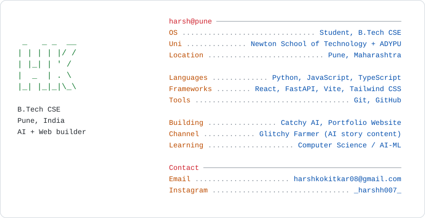

# 💫 Hi 👋, I'm Harsh Kokitkar
**Coder || Web Engineer || B.Tech CSE @ Newton School of Technology**

Email Me 👉 ✉️ **harshkokitkar08@gmail.com** for Collaboration / Projects / Anything Else 😊

---

## 👨‍💻 About Me

<picture>
  <source media="(prefers-color-scheme: dark)" srcset="https://raw.githubusercontent.com/harshkokitkar08-lang/harshkokitkar08-lang/main/dark_mode.svg">
  
</picture>

---

## 🛠️ Tech Stack

**Languages**

**Frameworks & Libraries**

**Tools**

---

## 🚀 Projects

| Project | Description | Stack |
|---|---|---|
| **Catchy AI** | AI image detection platform | Python, FastAPI, React, TypeScript |
| **Glitchy Farmer** | Story-based AI content channel | AI prompt design |

---

## 🐍 Contribution Snake

<picture>
  <source media="(prefers-color-scheme: dark)" srcset="https://raw.githubusercontent.com/harshkokitkar08-lang/harshkokitkar08-lang/output/github-snake-dark.svg" />
  
</picture>

---

### ✍️ Random Dev Quote

---

## 🌐 Socials

